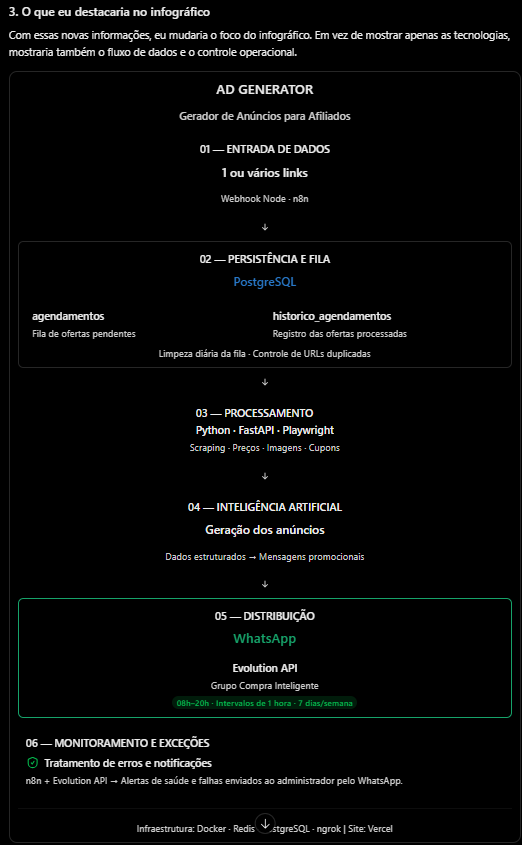
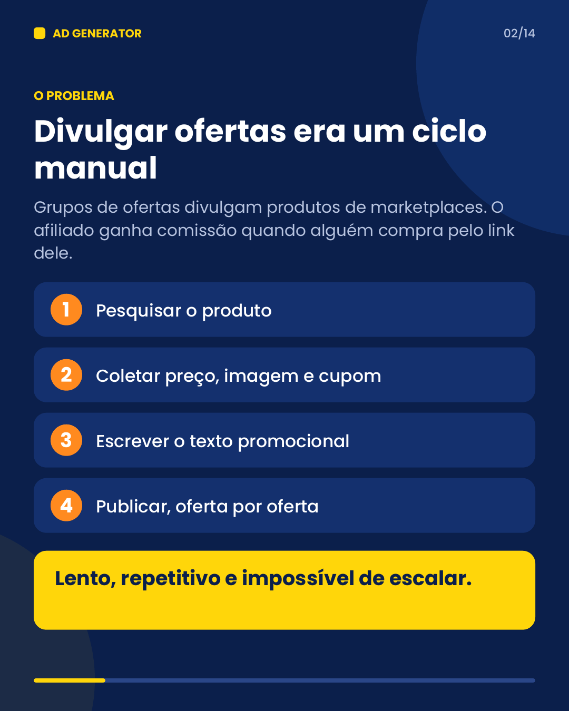
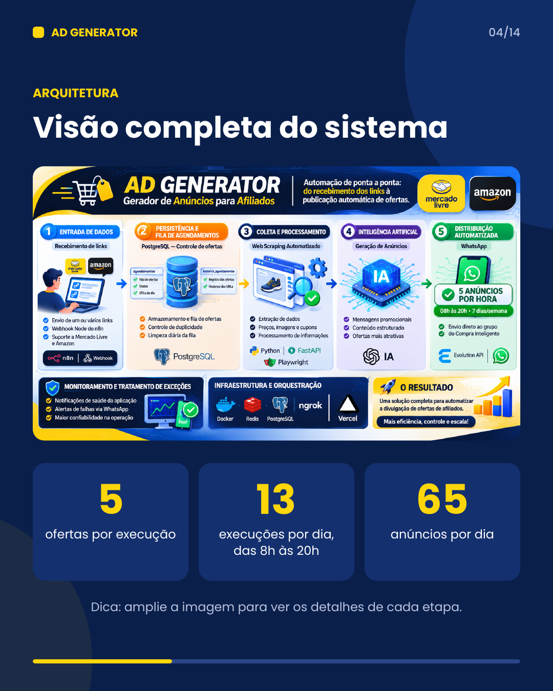
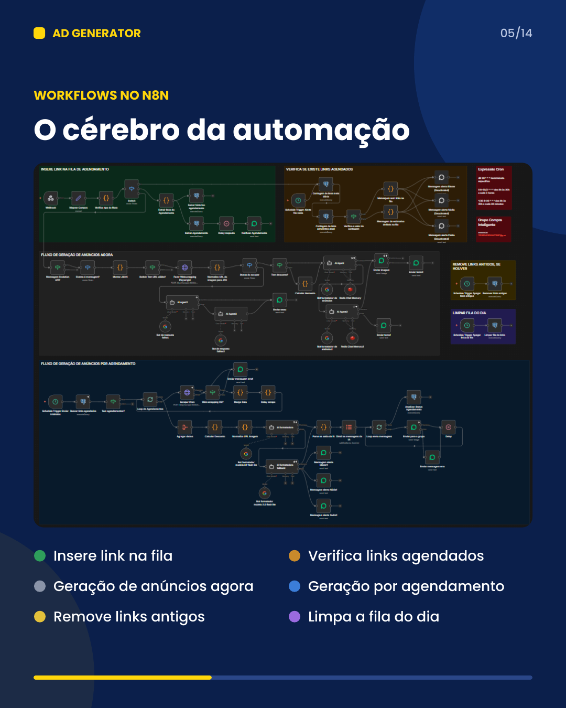
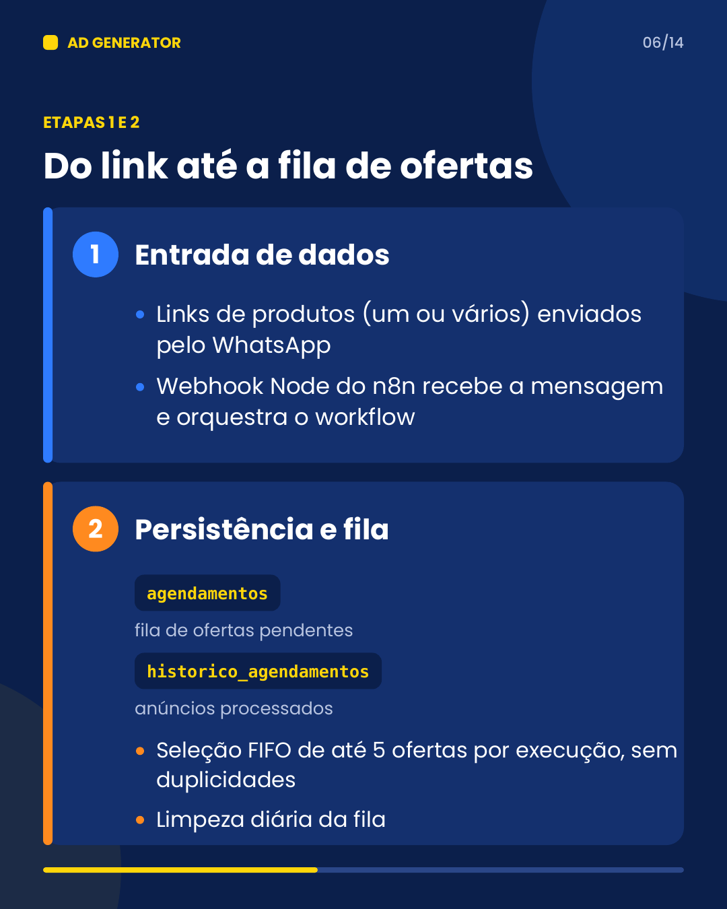
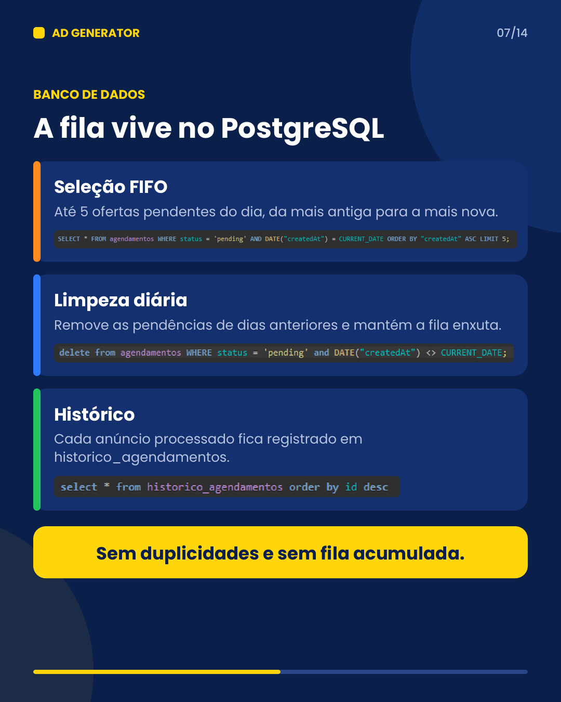
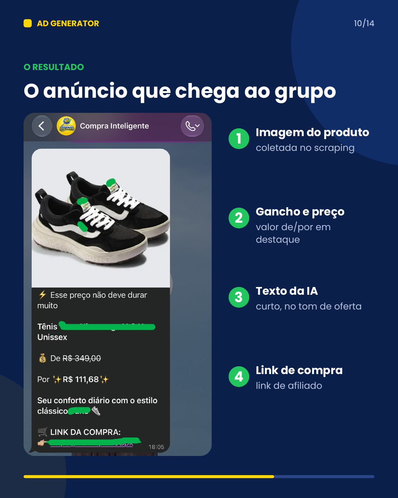
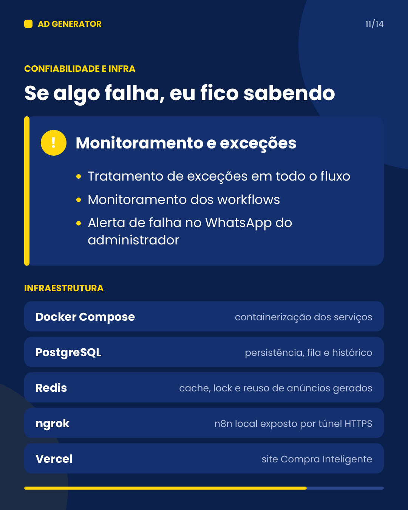
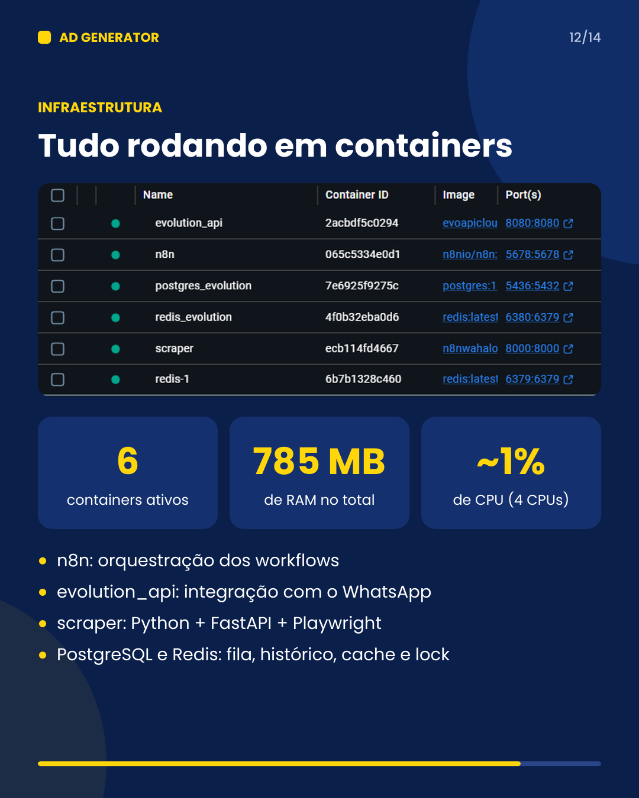
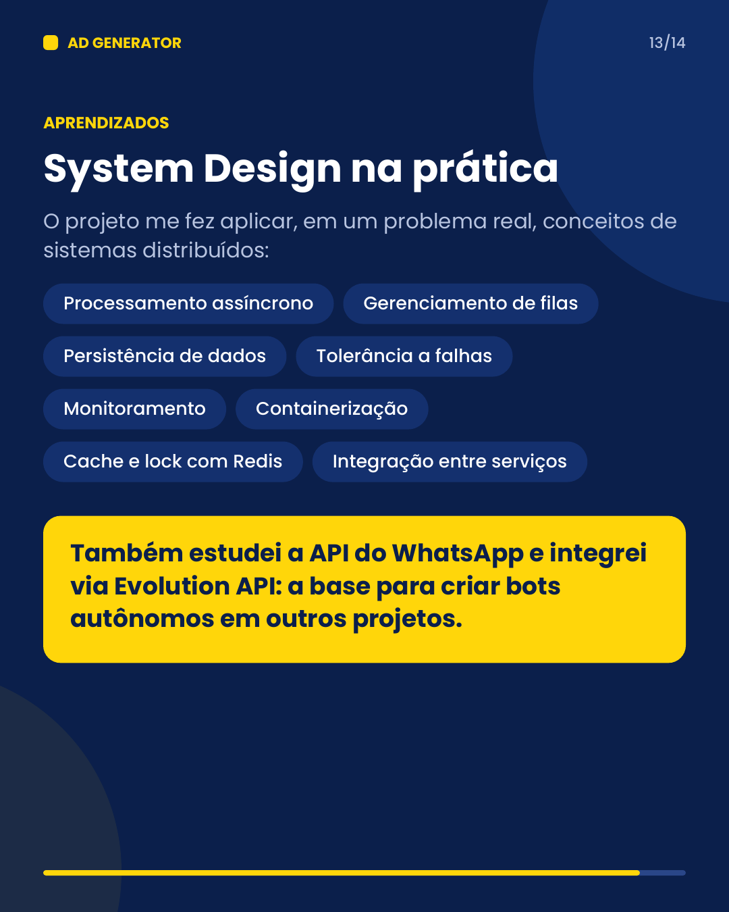

# 🚀 Ad Generator — anúncios de ofertas com IA, n8n e WhatsApp

Automação de ponta a ponta para operações de afiliados: recebe links de produtos, extrai e organiza os dados, prepara uma copy com IA e distribui ofertas pelo WhatsApp. A solução combina n8n, um microserviço de scraping em Python/FastAPI com Playwright, serviços de mensageria e infraestrutura em containers.

> **Fluxo resumido:** link do produto → extração → validação e formatação com IA → anúncio → WhatsApp.

## ✨ Visão geral

O projeto reduz o trabalho manual de pesquisar ofertas, conferir preços e cupons, preparar textos e publicar anúncios. O operador pode enviar um produto para processamento imediato, adicionar links à fila ou consultar o andamento das publicações.

### Infográfico

Veja o resumo visual dos princípios e do fluxo do projeto:



### Arquitetura

A arquitetura separa a orquestração do workflow, a extração de páginas de e-commerce, o processamento da copy e o envio das mensagens. Os serviços se comunicam pela rede interna do Docker Compose.


## 🖼️ Slides do projeto

A apresentação completa está disponível como [PDF para download](assets/Ad_Generator_Carrossel_LinkedIn_v5.pdf). Abaixo, os slides também podem ser visualizados individualmente:

<details>
<summary>Ver os 14 slides</summary>























</details>

## 🧩 Como funciona

```text
Operador / Webhook
       │
       ▼
n8n — valida entrada, identifica comandos e coordena as etapas
       │
       ├── Scraper (FastAPI + Playwright) — obtém dados do produto
       │
       ├── IA — prepara a copy com base nos dados extraídos
       │
       ├── Redis / PostgreSQL — cache, fila e persistência
       │
       ▼
Evolution API / WAHA — envia texto e imagem ao WhatsApp
```

### Componentes

| Componente | Tecnologia | Responsabilidade |
| --- | --- | --- |
| Orquestração | n8n | Recebe entradas, direciona os fluxos e agenda o processamento. |
| API de coleta | Python, FastAPI e Playwright | Extrai informações de páginas de produtos, incluindo Mercado Livre e Amazon. |
| Geração de texto | IA (Gemini no workflow documentado) | Formata a oferta a partir dos dados estruturados do produto. |
| Mensageria | Evolution API ou WAHA | Integra sessões do WhatsApp e envia mensagens e mídias. |
| Cache e filas | Redis | Apoia o gerenciamento de estado e filas dos serviços. |
| Persistência | PostgreSQL | Armazena dados utilizados pelos serviços e fluxos. |
| Infraestrutura | Docker Compose | Executa os componentes em containers conectados por rede interna. |

## 🤖 Operação do bot

O workflow principal é [`AdGenerator_v5.json`](AdGenerator_v5.json). Os comandos abaixo descrevem os modos documentados para o bot:

| Modo | Como acionar | Comportamento |
| --- | --- | --- |
| **Imediato** | Envie o link e a palavra `agora`. | Processa a oferta sem inseri-la na fila e responde ao remetente. |
| **Agendamento** | Envie um ou mais links sem `agora` ou `contagem`. | Registra os links para processamento programado. Cupons e descontos podem acompanhar os links. |
| **Contagem** | Envie uma mensagem com `contagem`. | Consulta o estado da fila e a meta diária conforme configurado no workflow. |

Exemplo de entrada com links, cupom e desconto:

```text
https://produto.mercadolivre.com.br/MLB-351294812 cupom VESTIRBEM, desc 12%
https://www.amazon.com.br/dp/B08N5WRWNW off 20%
```

Os horários, destinatários, limites e credenciais são definidos no workflow e na configuração local. Revise-os antes de usar em outro ambiente.

## 🛠️ Tecnologias e recursos

- Suporte de extração para páginas de marketplaces, incluindo Mercado Livre e Amazon.
- Normalização de URLs e imagens para facilitar o envio de mídia.
- Extração estruturada de links, cupons e descontos fornecidos na mensagem.
- Processamento sequencial de lotes e agendamento de anúncios.
- Checkpoints e logs para acompanhar a execução do scraper.
- Serviços isolados em containers Docker.

## 🚀 Executar localmente

1. Clone o repositório e configure as variáveis de ambiente localmente.
2. Confira o `docker-compose.yml` e ajuste as portas, credenciais e integrações para o seu ambiente.
3. Inicie os serviços:

   ```bash
   docker compose up -d
   ```

4. Confira o estado dos containers e os logs:

   ```bash
   docker compose ps
   docker compose logs -f
   ```

5. A documentação interativa do scraper, quando o serviço estiver ativo, fica em `http://localhost:8000/docs`.

Para interromper a stack:

```bash
docker compose down
```

> Configure credenciais reais somente em arquivos locais não versionados. Nunca publique chaves, senhas, tokens ou URLs de webhook privados. Consulte o `docker-compose.yml` e os workflows para identificar as variáveis necessárias neste checkout.

## 📁 Estrutura relevante

```text
.
├── AdGenerator_v4.json
├── AdGenerator_v5.json
├── docker-compose.yml
├── scraper/
│   ├── Dockerfile
│   ├── app.py
│   └── requirements.txt
├── n8n-workflows/                 # Outros workflows exportados
└── assets/
    ├── Ad_Generator_Carrossel_LinkedIn_v5.pdf
    ├── infografico_diretriz.png
    ├── Arquitetura_do_Gerador_de_Anúncios.png
    └── ad-generator-slides/       # Slides individuais da apresentação
```

## 👨‍💻 Desenvolvedor

**Eliezer Moraes** — [GitHub](https://github.com/eliezermoraesss) · [LinkedIn](https://www.linkedin.com/in/eliezer-moraes-silva-80b68010b)

## 📝 Licença

Este projeto está sob a licença [MIT](LICENSE).

---

<p align="center">Desenvolvido com 💙 por <a href="https://www.linkedin.com/in/eliezer-moraes-silva-80b68010b/">Eliezer Moraes Silva</a></p>
