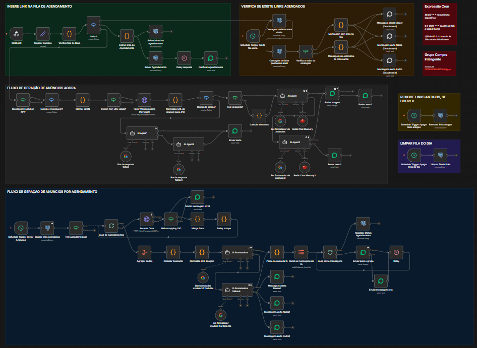
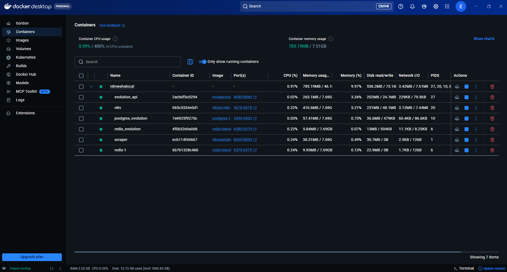

# 🚀 Ad Generator — Gerador de Anúncios de Ofertas com IA, n8n e WhatsApp

Solução completa de engenharia e automação de processos voltada para operações de afiliados, transformando a coleta, estruturação, copywriting com Inteligência Artificial e distribuição de ofertas em um fluxo automatizado, escalável e de alta conversão.



---

## 📌 Sobre o Projeto

### O Contexto e a Dor de Negócio

No mercado de marketing de afiliados (Mercado Livre, Amazon, Shopee e outros grandes marketplaces), o faturamento está diretamente correlacionado à velocidade e constância na publicação de promoções, cupons e oportunidades.

No entanto, o processo tradicional é estritamente manual e repetitivo. Para publicar uma única oferta, o operador precisa:

1. Encontrar o produto em promoção.
2. Acessar o marketplace e validar os preços (atual vs. original).
3. Coletar o nome do produto e a imagem principal.
4. Conferir a existência de cupons ativos e regras de frete.
5. Gerar e anexar o link de afiliado.
6. Redigir manualmente um texto persuasivo (copy) com emojis e formatação adequada.
7. Publicar a imagem e o texto em dezenas de grupos e canais no WhatsApp ou Telegram.

Esse fluxo gera um forte gargalo operacional: **para aumentar o faturamento, é necessário aumentar o trabalho braçal na mesma proporção**.

### A Solução

O **Ad Generator** transforma essa rotina manual em um pipeline automatizado de ponta a ponta:

```text
Link → Scraping → Processamento → IA → Oferta Formatada → WhatsApp
```

| Modelo                          | Fluxo de Ação                                                                                      |
| :------------------------------ | :--------------------------------------------------------------------------------------------------- |
| **Antes (Manual)**        | Pesquisar → Copiar → Formatar → Criar texto → Editar → Copiar imagem → Publicar                |
| **Depois (Ad Generator)** | **Fornecer o link → Processamento automático → Oferta gerada → Distribuição multicanal** |

### Destaques e Capacidades do Sistema

- **Suporte Específico para Marketplaces:** Tratamento dedicado para **Mercado Livre** e **Amazon**, identificando variações de layout, seletores dinâmicos e regras de extração.
- **Normalização de URLs e Links:** Tratamento robusto de URLs encurtadas, links diretos de afiliados e parâmetros de rastreamento.
- **Tratamento Automático de Imagens:** Normalização de formatos incompatíveis (como WEBP e PNG) convertendo-os para JPG padronizado antes do disparo.
- **Detecção Estruturada de Cupons:** Extração e parsing de cupons de desconto diretamente do conteúdo ou mensagem de entrada, repassando-os estruturados para a IA.
- **Processamento de Múltiplos Produtos (Lote):** Capacidade de receber listas de links e processá-los de forma sequencial com controle de taxa (*rate limiting*) e agregação inteligente de chamadas.
- **Checkpoints e Tratamento de Erros:** Rastreamento do ciclo de vida da requisição (desde o carregamento do DOM até a geração final da mensagem), facilitando diagnóstico e reexecução.

### Evolução Profissional e Engenharia

Mais do que utilizar diversas ferramentas isoladas, este projeto consolidou conceitos arquiteturais essenciais:

- Integração modular entre APIs REST e serviços heterogêneos.
- Web scraping resiliente com automação headless (Playwright).
- Orquestração de workflows de dados e lógica condicional com n8n.
- Persistência relacional (PostgreSQL) e cache de alta performance (Redis).
- Containerização e padronização de ambientes com Docker e Docker Compose.
- Engenharia de prompts com IA para copywriting orientado a conversão, eliminando alucinações e mantendo fidelidade aos dados reais do produto.

---

## 🧩 Como Funciona

### Visão Geral da Arquitetura

Um dos pilares do projeto é a **separação clara de responsabilidades**: o orquestrador não deve executar tarefas pesadas de renderização de navegador, assim como os coletores não devem cuidar de regras de negócio ou de mensageria.

```
┌──────────────────────────────────────────────────────────────────────────────────┐
│                                   ENTRADA                                        │
│          WhatsApp (Mensagem) / Webhook n8n / Disparo em Lote de URLs             │
└────────────────────────────────────────┬─────────────────────────────────────────┘
                                         │
                                         ▼
┌──────────────────────────────────────────────────────────────────────────────────┐
│                                   n8n (5678)                                     │
│                     Orquestrador de Workflows & Regras                           │
└──────────────┬────────────────────────────────────────────────────┬──────────────┘
               │ (Chama API de Scraping)                            │
               ▼                                                    │
┌──────────────────────────────┐                                    │
│   Scraper (FastAPI + 8000)   │                                    │
│   Playwright Headless Engine │                                    │
│   • Mercado Livre / Amazon   │                                    │
│   • Normalização de imagens  │                                    │
│   • Checkpoints de execução  │                                    │
└──────────────┬───────────────┘                                    │
               │ (Retorna JSON com dados)                           │
               ▼                                                    │
┌──────────────────────────────┐                                    │
│ Inteligência Artificial (IA) │                                    │
│ • Copywriting promocional    │                                    │
│ • Formatação WhatsApp        │                                    │
│ • Destaque de cupom e preço  │                                    │
└──────────────┬───────────────┘                                    │
               │ (Oferta pronta)                                    │
               └───────────────────────┬────────────────────────────┘
                                       │
                                       ▼
┌──────────────────────────────────────────────────────────────────────────────────┐
│                           Evolution API / WAHA (8080)                            │
│                       Gateway de Mensageria WhatsApp                             │
└──────────────────────────────────────┬───────────────────────────────────────────┘
                                       │ (Disparo de Imagem + Texto)
                                       ▼
┌──────────────────────────────────────────────────────────────────────────────────┐
│                   Grupos, Comunidades e Canais de Afiliados                      │
└──────────────────────────────────────────────────────────────────────────────────┘
```

---

### Componentes e Papel de Cada Tecnologia

| Componente                 | Tecnologia                            | Responsabilidade Principal                                                                                                                               |
| :------------------------- | :------------------------------------ | :------------------------------------------------------------------------------------------------------------------------------------------------------- |
| **Orquestrador**     | `n8n`                               | Recebe as entradas, direciona o fluxo, coordena as chamadas HTTP, gerencia os checkpoints e bifurcações (ex: produto com imagem vs. sem imagem).       |
| **API de Coleta**    | `Python + FastAPI`                  | Expõe endpoints REST internos (`/scrape`, `/health`) com tipagem, documentação Swagger e controle assíncrono.                                    |
| **Automação Web**  | `Playwright`                        | Inicializa navegadores Chromium headless, executa espera explícita por elementos (`domcontentloaded`, seletores de preço/título) e contorna SPAs.   |
| **Copywriting**      | `Inteligência Artificial (Gemini)` | Processa o JSON estruturado do produto e produz a mensagem final de vendas, aplicando técnicas de persuasão, gatilhos de urgência e links rastreados. |
| **Gateway WhatsApp** | `Evolution API` *(ou WAHA)*       | Conecta instâncias do WhatsApp via QR Code/Webhook, provendo envio de mensagens de texto, mídias e tratamento de eventos em tempo real.                |
| **Cache & Filas**    | `Redis`                             | Garante controle de taxa de requisições, idempotência (evitando envio repetido de ofertas) e cache de sessões da API do WhatsApp.                    |
| **Banco de Dados**   | `PostgreSQL`                        | Persistência das instâncias do WhatsApp, histórico de publicações, fila de agendamento de links e métricas de meta diária.                        |
| **Infraestrutura**   | `Docker Compose`                    | Padroniza e isola toda a stack em containers conectados por uma rede interna unificada (`evolution_n8n_net`).                                          |

---

## 🤖 Workflow AdGenerator v5 — Triggers, Horários e Comandos do Bot

O workflow principal [AdGenerator_v5.json](<file:///e:/N8N%20Waha%20Local/AdGenerator_v5.json>) implementa inteligência de roteamento de comandos, agendamentos cronometrados, controle de metas diárias e envio para o grupo oficial de afiliados.

### 1. Triggers e Agendamentos Cron

| Trigger / Gatilho                                   | Tipo           | Expressão Cron / Path                                 | Horário / Frequência                                 | Ação Executada                                                                                                                                                         |
| :-------------------------------------------------- | :------------- | :----------------------------------------------------- | :----------------------------------------------------- | :----------------------------------------------------------------------------------------------------------------------------------------------------------------------- |
| **`Webhook`**                               | Webhook HTTP   | `POST /webhook/d5260661-3a03-4695-83d0-7faa4a304f67` | Tempo real                                             | Recebe eventos de mensagens do WhatsApp (`messages.upsert`) enviadas pelo operador para o bot.                                                                         |
| **`Schedule Trigger Enviar Anúncios`**     | Agendador Cron | `0 8-21 * * *`                                       | Das **08:00 às 21:00**, a cada hora cheia       | Busca até **5 links pendentes** na fila do PostgreSQL, realiza o scraping em lote, aciona a IA e publica no **Grupo Compra Inteligente** com imagem e copy. |
| **`Schedule Trigger Alerta fila vazia`**    | Agendador Cron | `30 7-20 * * *`                                      | Das **07:30 às 20:30**, a cada hora (minuto 30) | Audita a fila. Se estiver vazia, alerta os operadores no WhatsApp. Se contiver links, calcula e atualiza a projeção para bater a **meta de 65 anúncios/dia**.   |
| **`Schedule Trigger Apagar links da fila`** | Agendador Cron | `5 21 * * *`                                         | Diariamente às **21:05**                        | Limpa os links restantes da fila do dia no banco de dados após o término da janela de disparos.                                                                        |
| **`Schedule Trigger Apagar links antigos`** | Agendador Cron | `10 8 * * *`                                         | Diariamente às **08:10**                        | Expurga registros e históricos obsoletos para manutenção e performance do PostgreSQL.                                                                                 |

---

### 2. Tipos de Acionamento via Mensagem no WhatsApp

O nó **`Verifica tipo do fluxo`** analisa a mensagem recebida pelo bot via expressão regular e a classifica em um dos 3 modos operacionais:

```javascript
const message = $json.message || "";
const agora = /\bagora\b/i;
const contagem = /\bcontagem\b/i;

let tipoFluxo = "agendamento";

if (agora.test(message)) {
  tipoFluxo = "agora";
} else if (contagem.test(message)) {
  tipoFluxo = "contagem";
}
```

```
                     ┌──────────────────────────────┐
                     │  Mensagem recebida no bot    │
                     └──────────────┬───────────────┘
                                    │
                                    ▼
                     ┌──────────────────────────────┐
                     │   Verifica tipo do fluxo     │
                     └──────┬───────┬───────┬───────┘
                            │       │       │
            ┌───────────────┘       │       └───────────────┐
            ▼                       ▼                       ▼
   Contém "agora"          Contém "contagem"         Apenas links / texto
            │                       │                       │
            ▼                       ▼                       ▼
┌───────────────────────┐ ┌───────────────────┐ ┌───────────────────────┐
│     FLUXO "AGORA"     │ │ FLUXO "CONTAGEM"  │ │  FLUXO "AGENDAMENTO"  │
│ Processamento em      │ │ Consulta status e │ │ Salva na fila do      │
│ tempo real imediato   │ │ projeção da meta  │ │ PostgreSQL para envio │
│ e resposta direta     │ │ de 65 links/dia   │ │ de 5/hora (8h às 21h) │
└───────────────────────┘ └───────────────────┘ └───────────────────────┘
```

---

### 3. Como Operar o Bot no WhatsApp (Exemplos de Mensagens e Respostas)

#### ⚡ Modo 1: Disparo Imediato (`agora`)

- **Objetivo:** Processar e postar uma oferta relâmpago urgente ou testar a formatação de um produto imediatamente, sem entrar na fila de agendamento.
- **Como acionar:** Envie uma mensagem contendo o link do produto e a palavra **`agora`** (maiúscula ou minúscula).
- **Exemplos de mensagens enviadas pelo operador:**

  ```text
  agora https://www.mercadolivre.com.br/p/MLB28941235
  ```

  ```text
  processa agora https://www.amazon.com.br/dp/B09XYZ cupom TECH10
  ```

  ```text
  https://mercadolivre.com/sec/2aBcDe manda agora, desc 15%
  ```
- **Comportamento do Bot:**

  1. Identifica a palavra `agora` e ignora a fila do banco.
  2. Dispara requisição direta ao Scraper Playwright (`http://scraper:8000/scrape`).
  3. Envia os dados estruturados para o **AI Agent (Gemini)** formatar a copy.
  4. Converte a imagem do produto para JPG.
  5. Envia a resposta **imediatamente no chat individual do remetente** com a foto e a legenda formatada.
  6. *Tratamento de erro:* Se o produto estiver fora de estoque ou a página demorar (timeout), a IA de contingência responde de forma amigável informando a indisponibilidade e solicitando outro link.

---

#### 📅 Modo 2: Inserção na Fila de Agendamento (`agendamento`)

- **Objetivo:** Abastecer a operação diária. O operador envia um ou múltiplos produtos para serem postados automaticamente de hora em hora (5 por hora) no **Grupo Compra Inteligente** (`120363406064472961@g.us`).
- **Como acionar:** Envie links sem usar a palavra `agora` ou `contagem`. É possível enviar **vários links em uma única mensagem** (um por linha), além de cupons e descontos.
- **Sintaxe de extração suportada pelo bot:**
  - **URLs:** Qualquer link iniciado com `http://` ou `https://`.
  - **Cupons:** `cupom NOME_DO_CUPOM`
  - **Descontos:** `desc 10%`, `desconto 15`, `off 20%`, `descontar 12`
- **Exemplo de mensagem enviada pelo operador:**
  ```text
  https://produto.mercadolivre.com.br/MLB-351294812 cupom VESTIRBEM, desc 12%
  https://www.amazon.com.br/dp/B08N5WRWNW off 20%
  https://mercadolivre.com/sec/1v9xKLa
  ```
- **Resposta imediata do Bot no WhatsApp:**
  ```text
  Link(s) recebido(s) e agendado(s) com sucesso para disparos automáticos! ✅
  ```
- **Execução posterior:** Das 08:00 às 21:00, no minuto `00` de cada hora, o trigger automático pega os próximos 5 links da fila, gera as artes/copies e posta no grupo oficial.

---

#### 📊 Modo 3: Consulta de Fila e Meta Diária (`contagem`)

- **Objetivo:** Consultar em tempo real quantos anúncios já foram gerados, quantos ainda estão na fila e a previsão do último horário de envio.
- **Como acionar:** Envie uma mensagem contendo a palavra **`contagem`**.
- **Exemplos de mensagens enviadas pelo operador:**

  ```text
  contagem
  ```

  ```text
  qual a contagem?
  ```
- **Respostas possíveis enviadas pelo Bot:**

  - **Fluxo com links na fila (em andamento):**
    ```text
    recebi até o momento *35 de 65 links* previstos para hoje! 📌

    Precisamos de mais *15 links* para manter os 5 anúncios por hora até às 21h. 🎯

    O último horário de envio previsto hoje será às *18h*! ⏰

    *Pra cima que foguete não tem ré! (exceto o do Elon Musk kkk)* 🚀
    ```
  - **Quando a meta diária foi atingida:**
    ```text
    recebi até o momento *65 de 65 links* previstos para hoje! 📌

    🎉 Meta diária já foi atingida, não é necessário enviar mais links hoje!

    *Pra cima que foguete não tem ré! (exceto o do Elon Musk kkk)* 🚀
    ```
  - **Quando há excesso de links acumulados:**
    ```text
    recebi até o momento *50 de 65 links* previstos para hoje! 📌

    Já recebi links o suficiente! Não será possível enviar todos hoje. ⚠️ 

    Restam apenas *15 anúncios* para serem gerados até às *21h* e tenho 28 ainda pendentes na fila! ⏰

    *Pra cima que foguete não tem ré! (exceto o do Elon Musk kkk)* 🚀
    ```
  - **Fora da janela de operação (após às 21h):**
    ```text
    horário de envio automático já encerrou por hoje. ⛔

    Voltamos amanhã a partir das 8h! 🌅
    ```

---

### 4. Alertas Proativos aos Operadores

O sistema monitora a saúde operacional e notifica diretamente os administradores no WhatsApp:

- **Alerta de Fila Vazia (07:30 às 20:30):**
  Se o `Schedule Trigger Alerta fila vazia` rodar e constatar zero links na fila, envia mensagem individual para **Eliezer**, **Nádia** e **Pedro**:
  ```text
  [Nome do Operador], estou sem links para gerar os anúncios...

  Por favor, assim que puder, me envie links para mantermos nossos ganhos, tá bom? 😉
  ```
- **Alerta de Instabilidade de IA (Fallback):**
  Caso o modelo da IA sofra instabilidade no horário agendado:
  ```text
  Infelizmente a IA que eu uso para formatar os anúncios neste horário está com instabilidades 😕 Não se preocupe que tentarei novamente mais tarde❗
  ```

---

### 5. Padrão Visual e Regras de Copywriting (IA Gemini)

As mensagens geradas pela Inteligência Artificial seguem um rigoroso padrão de copywriting persuasivo:

```text
*🔥 Esse preço não deve durar muito*

*Smartphone Samsung Galaxy S23 5G 128GB*

💰 De ~R$ 3.499,00~

Por 🔥*R$ 2.799,00*🔥

🏷️ Cupom: `GANHE100`

*Tecnologia de ponta para elevar seu dia a dia ao máximo! 🚀*

🛒 *LINK DA COMPRA:*
👉🏼 https://mercadolivre.com/sec/...
```

#### Regras Obrigatórias de Formatação:

1. **Frase de Efeito Inicial:** Gancho com urgência, emoção ou curiosidade em negrito (ex: `*⚡ Últimas horas nesse valor*`, `*🤯 Esse preço me surpreendeu*`).
2. **Descrição do Produto:** Até 7 palavras descritivas, incluindo marca e quantidade, sem termos repetidos.
3. **Preço Anterior Tachado:** Exibido com `~R$ valor~` somente quando houver desconto real de no mínimo R$ 10,00.
4. **Preço Atual em Destaque:** Sempre entre emojis de fogo ou brilho (ex: `Por 🔥*R$ Preço atual*🔥`).
5. **Cupom Monospaçado:** Destacado com crases (`` `CUPOM` ``) para facilitar que o usuário copie com um toque no WhatsApp.
6. **Frase Marketeira:** Até 10 palavras conectando o produto à necessidade e desejo do cliente.
7. **Formatação de Negrito para WhatsApp:** Uso rigoroso de asterisco único `*texto*` (nunca `**texto**`), garantindo renderização limpa no WhatsApp.

---

## ⚙️ Operacional

### 1. Fluxo de Operação no Dia a Dia

```text
[1. ENTRADA]      Operador envia o link (ou lote de links) via WhatsApp ou dispara o Webhook do n8n.
       │
[2. PARSER]       O n8n identifica a URL, extrai parâmetros e detecta o marketplace (Mercado Livre, Amazon, etc.).
       │
[3. SCRAPING]     Requisição POST enviada para o Scraper (FastAPI:8000).
                   O Playwright abre o link, aguarda os elementos de preço/título e retorna o JSON estruturado.
       │
[4. VALIDAÇÃO]    Checkpoint no n8n: se houver falha na extração ou bloqueio, registra log e notifica o administrador.
       │
[5. IMAGEM]       Download e normalização automática da imagem do produto (conversão de WEBP/PNG para JPG).
       │
[6. IA COPY]      A IA recebe os dados exatos (título, preço anterior, preço atual, cupom, frete, link) e gera a copy persuasiva.
       │
[7. BANCO/CACHE]  Verificação de duplicidade no Redis e registro do histórico no PostgreSQL.
       │
[8. DISPARO]      Evolution API envia a imagem com a legenda formatada diretamente para os grupos/canais de WhatsApp configurados.
```

---

### 2. Checkpoints de Execução e Diagnóstico

Durante o ciclo de vida do scraping, o serviço emite checkpoints detalhados no log para facilitar a identificação imediata de instabilidades ou alterações de seletores nos e-commerces:

```text
[CHECKPOINT] start
[CHECKPOINT] playwright_started
[CHECKPOINT] browser_launched
[CHECKPOINT] before_goto
[CHECKPOINT] after_goto
[CHECKPOINT] mercado_livre_detected (ou amazon_detected)
[CHECKPOINT] domcontentloaded
[CHECKPOINT] after_wait_title
[CHECKPOINT] data_extracted_success
```

---

### 3. Estrutura de Arquivos do Projeto

```
E:\N8N Waha Local
├── AdGenerator_v4.json              # Workflow n8n v4
├── AdGenerator_v5.json              # Workflow n8n v5 (com IA, lotes, agendamento e alertas)
├── Bom dia AdGenerator.json        # Workflow de engajamento diário
├── Status Servidor AdGenerator.json # Monitoramento de saúde dos containers
├── descritivo-tecnico-comercial.md  # Detalhamento de produto e proposta comercial
├── docker-compose.yml               # Definição e orquestração de todos os containers
├── .env                             # Variáveis de ambiente e credenciais
├── scraper/                         # Serviço de Web Scraping em Python
│   ├── Dockerfile
│   ├── app.py                      # Aplicação FastAPI + Playwright
│   └── requirements.txt            # Dependências Python
└── assets/                          # Imagens e recursos visuais
```

---

### 4. Configuração das Variáveis de Ambiente (`.env`)

Crie e mantenha o arquivo `.env` na raiz do projeto configurando as credenciais dos serviços:

```env
# ==========================================
# n8n Orchestrator
# ==========================================
N8N_HOST=localhost
N8N_PORT=5678
N8N_PROTOCOL=http
WEBHOOK_URL=http://localhost:5678/
GENERIC_TIMEZONE=America/Sao_Paulo
N8N_COMMUNITY_PACKAGES_ALLOW_TOOL_USAGE=true

# ==========================================
# Scraper Service (Python / FastAPI)
# ==========================================
SCRAPER_PORT=8000
PLAYWRIGHT_BROWSERS_PATH=/ms-playwright

# ==========================================
# Evolution API (WhatsApp)
# ==========================================
EVOLUTION_PORT=8080
AUTHENTICATION_API_KEY=9F2D1B7A6C8E4F2E9A7C0B5D1E3F8A6D
SERVER_URL=http://localhost:8080

# ==========================================
# PostgreSQL Database (Evolution API & Agendamentos)
# ==========================================
POSTGRES_USER=user
POSTGRES_PASSWORD=pass
POSTGRES_DB=evolution_db
POSTGRES_PORT=5436

# ==========================================
# Redis Cache & Queues
# ==========================================
REDIS_N8N_PORT=6379
REDIS_EVOLUTION_PORT=6380
```

---

### 5. Guia de Execução da Infraestrutura

#### Iniciar todos os serviços

```bash
cd "E:\N8N Waha Local"
docker compose up -d
```

#### Verificar status dos containers

```bash
docker compose ps
```

#### Acompanhar logs em tempo real

```bash
# Todos os containers
docker compose logs -f

# Apenas o orquestrador (n8n)
docker compose logs -f n8n

# Apenas o serviço de scraping
docker compose logs -f scraper

# Apenas a Evolution API
docker compose logs -f evolution_api
```

#### Rebuild do serviço Scraper após alterações no código

```bash
docker compose build --no-cache scraper
docker compose up -d scraper
```

#### Parar a stack

```bash
docker compose down
```

---

## 🐳 Detalhamento dos Containers da Stack

### 1. `n8n` — Workflow Automation

- **Imagem:** `n8nio/n8n:latest`
- **Porta Host:** `5678` (`http://localhost:5678`)
- **Volume:** `n8n_data:/home/node/.n8n`
- **Função:** Central de inteligência de fluxos, integração de APIs, regras condicionais e interface de monitoramento.

### 2. `scraper` — Microserviço de Scraping

- **Imagem:** Build local a partir de `./scraper` (Python 3.10 + FastAPI + Playwright)
- **Porta Host:** `8000` (`http://localhost:8000/docs`)
- **Endpoints:**
  - `GET /health` — Verificação de saúde da aplicação
  - `POST /scrape` — Recebe URL e retorna título, preços, cupom e imagem
- **Função:** Isolamento do processo de renderização e extração de páginas pesadas de e-commerce.

### 3. `evolution_api` — WhatsApp Gateway

- **Imagem:** `evoapicloud/evolution-api:latest`
- **Porta Host:** `8080` (`http://localhost:8080`)
- **Banco:** PostgreSQL 15 (`postgres_evolution`)
- **Cache:** Redis (`redis_evolution`)
- **Função:** Gerenciamento de sessões de WhatsApp, QR Code, webhooks de mensagens e envio de mídias.

### 4. `postgres_evolution` — Banco de Dados

- **Imagem:** `postgres:15`
- **Porta Host:** `5436` (mapeada para `5432` interno)
- **Volume:** `postgres_evolution_data:/var/lib/postgresql/data`
- **Função:** Persistência relacional das instâncias, mensagens da Evolution API e tabela de agendamentos de links.

### 5. `redis_evolution` — Cache WhatsApp

- **Imagem:** `redis:latest`
- **Porta Host:** `6380` (mapeada para `6379` interno)
- **Função:** Sessões ativas e cache da Evolution API.

### 6. `redis` — Cache do n8n

- **Imagem:** `redis:latest`
- **Porta Host:** `6379`
- **Função:** Gerenciamento de filas de execução e estado para o n8n.

---

## 🔌 Networking Interno

Todos os containers comunicam-se via bridge network `evolution_n8n_net`, utilizando resolução de nomes DNS interna:

- `http://n8n:5678`
- `http://scraper:8000`
- `http://evolution_api:8080`
- `postgresql://postgres_evolution:5432`
- `redis://redis_evolution:6379`

---

## 🔐 Segurança e Boas Práticas

- **Credenciais em Produção:** Altere as senhas padrão do PostgreSQL, chaves de API da Evolution API e segredos do n8n no arquivo `.env`.
- **Exposição Pública:** Para receber webhooks externos com HTTPS seguro, utilize túneis como **Ngrok** ou configure um reverse proxy (Nginx / Traefik com SSL Let's Encrypt).
- **Anti-bloqueio:** Utilize intervalos mínimos entre requisições de scraping para respeitar as políticas de requisição dos marketplaces.

---

## 📈 Resultados e Benefícios Obtidos

- **Escala de Operação:** Aumento de até 10x na capacidade diária de postagem de produtos sem acréscimo de tempo manual.
- **Padronização Visual:** Todas as mensagens seguem a mesma identidade de marca, pontuação, uso de emojis e diagramação.
- **Fidelidade de Informação:** Preços e cupons são validados no momento exato da extração, evitando ofertas desatualizadas.
- **Resiliência:** Arquitetura desacoplada que permite atualizar o scraper ou o provedor de IA sem afetar a orquestração geral.

## 👨‍💻 Desenvolvedor

| [<br><sub>Eliezer Moraes</sub>](https://github.com/eliezermoraesss) |
| :---: |

- **Email**: [eliezer.moraes@outlook.com](mailto:eliezer.moraes@outlook.com)
- **LinkedIn**: [Eliezer Moraes Silva](https://www.linkedin.com/in/eliezer-moraes-silva-80b68010b)
- **GitHub**: [@eliezermoraesss](https://github.com/eliezermoraesss)
- **Instagram**: [@eliezer.moraesss](https://www.instagram.com/eliezer.moraesss/)
- **Wakatime**: [@eliezermoraes](https://wakatime.com/@eliezermoraes)

## 📝 Licença

Este projeto está sob a licença [MIT](LICENSE).

---

<p align="center">Desenvolvido com 💙 por <a href="https://www.linkedin.com/in/eliezer-moraes-silva-80b68010b/">Eliezer Moraes Silva</a></p>